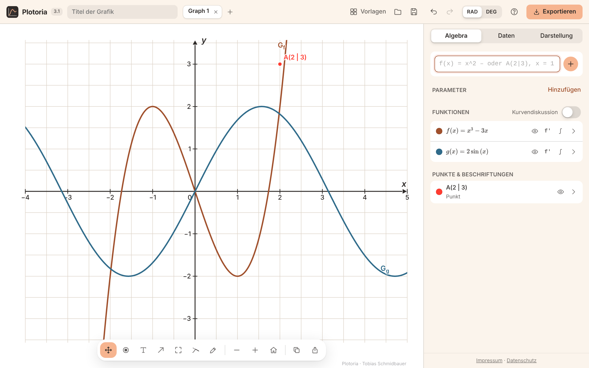
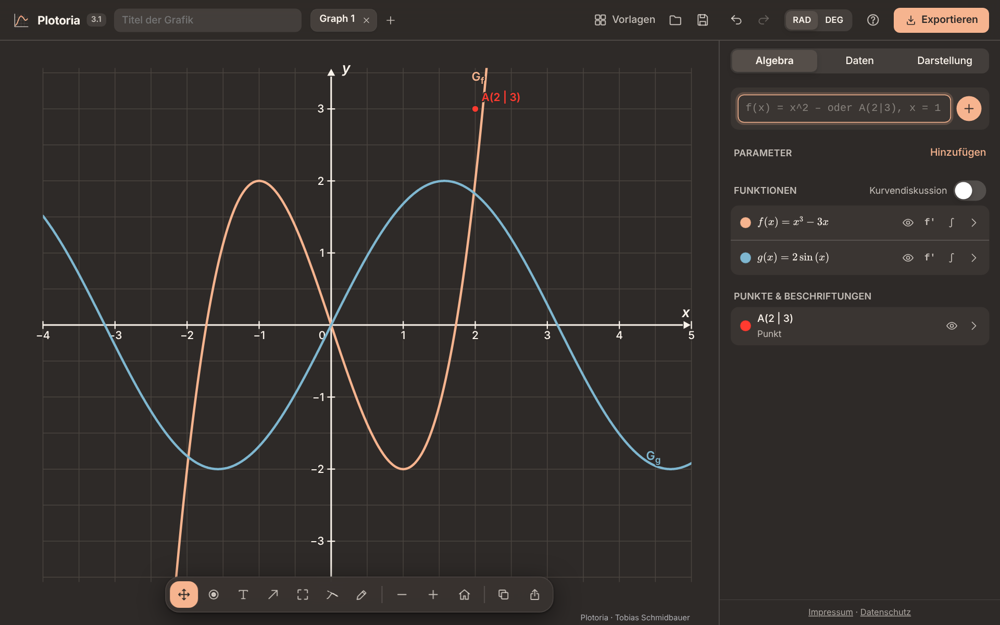
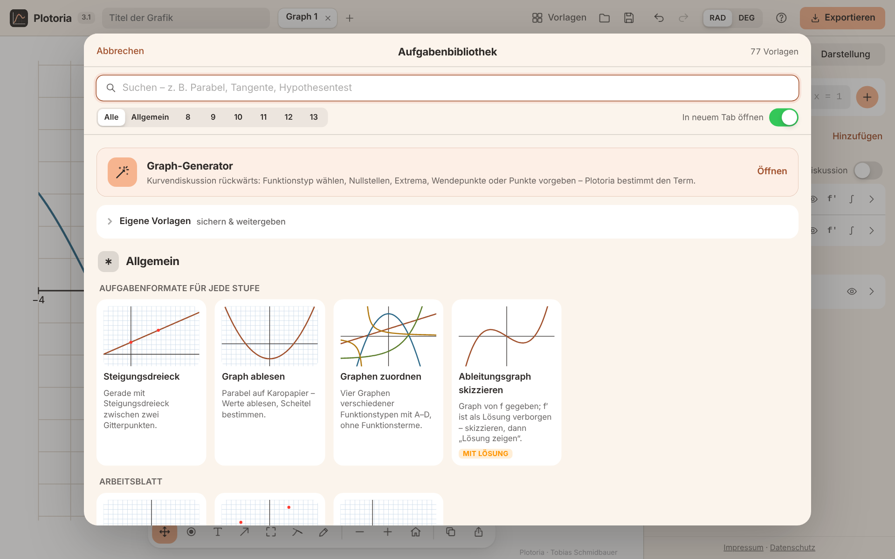

# Plotoria 3.1

**Graphen für Arbeitsblätter und Prüfungen: maßstabsgetreu, druckfertig, auch offline.**

[**Plotoria im Browser öffnen**](https://tjrschmidbauer.github.io/Plotoria/) · [Bedienungsanleitung](ANLEITUNG.md) · [Änderungsprotokoll](CHANGELOG.md) · [Impressum](https://schmidbauer.io/impressum/) · [Datenschutz](https://schmidbauer.io/datenschutz/)



Plotoria ist ein Funktionsplotter für Schule und Unterricht. Lehrkräfte erstellen damit Graphen, bearbeiten sie (Beschriftungen, Punkte, Pfeile, Definitionsbereiche, Lückentabellen) und exportieren sie in exakter Größe für Word, LaTeX oder den Druck. Plotoria läuft im Browser, ohne Anmeldung und ohne Server.

## Auf einen Blick

| Bereich | Was Plotoria kann |
|---|---|
| Funktionen | Terme, abschnittsweise Definitionen, Funktionsscharen, Parameter mit Schiebereglern, Ableitungen, Stammfunktion, Umkehrfunktion |
| Analysis | Nullstellen, Extrema, Wendepunkte, Asymptoten, Tangente und Normale, Integral, Riemann-Summen, Kurvendiskussion als Text |
| Aufgaben | Bibliothek mit 77 Vorlagen für Jgst. 8 bis 13, Graph-Generator, Skizzieren und Prüfen, Lückentabellen |
| Stochastik | Binomial- und Normalverteilung mit markiertem Bereich und Tabelle |
| Export | PNG (300 dpi), SVG, TikZ, PDF; „1 Einheit = 1 cm“ oder feste Größe in cm; Druckbogen DIN A4 |
| Bedienung | Hell- und Dunkelmodus, Touch, Tabs, Rückgängig, Teilen per Link, offline als App installierbar |

## Dunkelmodus und Aufgabenbibliothek

Hell- und Dunkelmodus folgen den Systemeinstellungen. Die Farben stammen aus dem Markenhandbuch von [schmidbauer.io](https://schmidbauer.io/).



Die Aufgabenbibliothek ordnet 77 Vorlagen nach Jahrgangsstufe und Lernbereich des LehrplanPLUS Gymnasium Bayern, mit Suche und Filter. Der Graph-Generator löst Steckbriefaufgaben rückwärts.



## Funktionen

### Neu in Version 3.1

* **Graph-Generator:** Funktionstyp wählen, Nullstellen, Extrema, Wende- und Terrassenpunkte, Polstellen oder Punkte vorgeben. Plotoria bestimmt den Term exakt, prüft die Vorgaben und schlägt schöne Varianten vor.
* **Tabs:** mehrere Graphen gleichzeitig bearbeiten, jeder mit eigenem Rückgängig-Verlauf. Der Druckbogen sammelt aus allen Tabs.
* **Aufgabenbibliothek Jgst. 8 bis 13:** 77 Vorlagen mit Suche und Filter. Universelle Formate stehen zusätzlich unter „Allgemein“.
* **Stochastik:** Binomialverteilung (Histogramm) und Normalverteilung (Glockenkurve) mit markiertem Bereich, P(X ≤ k), μ ± σ und Tabelle, zum Beispiel `X ~ B(20; 0,3); P(X ≤ 4)`.
* **Skizzieren und prüfen:** Freihandskizzen mit Stift oder Finger. Als Lösung verborgene Graphen lassen sich mit „Lösung zeigen“ (L) samt Toleranzschlauch und Auswertung prüfen. Der Export gibt es mit oder ohne Lösungen.

### Neu in Version 3.0

* **Abschnittsweise definierte Funktionen:** `f(x) = x² für x < 1; 2x − 1 für x ≥ 1`, mit gefülltem und offenem Randpunkt an Sprungstellen.
* **Funktionsscharen:** `f_a(x) = a·x² für a = 1, 2, 3`, jede Kurve automatisch beschriftet.
* **Umkehrfunktion** per Klick: Spiegelung an y = x mit Winkelhalbierender.
* **Stammfunktion** F mit wählbarer Konstante C, auch als Schar, exakt oder numerisch.
* **Hilfslinien** zum Ablesen: gestrichelte Lote von Punkten auf beide Achsen.
* **Riemann-Summen:** Unter-, Ober- und Mittelsumme mit einstellbarer Rechteckzahl.
* **Kurvendiskussion als Text:** Definitionsbereich, Symmetrie, Nullstellen, Extrema, Wendepunkte, Monotonie, Krümmung, Grenzverhalten, für Word, LaTeX oder den Druckbogen.
* **Mehrere Koordinatensysteme auf einem Blatt:** leeres Raster („Skizziere f′“) neben dem Graphen.
* **Eigene Vorlagen:** aktuellen Stand sichern und als Datei mit Kolleginnen und Kollegen tauschen.

### Prüfungen und Arbeitsblätter

* **Maßstabsgetreuer Export:** „1 Einheit = 1 cm“ oder feste Größe in cm als PNG (300 dpi, Word übernimmt die Größe), SVG, TikZ oder PDF.
* **Druckbogen DIN A4:** Grafiken und Tabellen sammeln, mit Kopfzeile „Name / Klasse / Datum“ drucken oder als PDF sichern.
* **Schwarz-Weiß-Modus:** Strichmuster statt Farben, schraffierte Flächen, kopiertauglich.
* **Karopapier:** 5-mm-Kästchen mit festem Maßstab wie im Schulheft.
* **Beschriftungen je Graph:** G_f, Funktionsterm, eigener Text oder keine.
* **Punkte, Texte, Pfeile, senkrechte Geraden** per Werkzeug oder Eingabe, zum Beispiel `A(2|3)` oder `x = 2`.
* **Definitionsbereiche** (`f(x) = x² für 0 ≤ x < 3`) mit offenen und geschlossenen Randpunkten.
* **Asymptoten** senkrecht, waagrecht und schief.
* **Achsen frei skalieren:** Schritte wie `pi/2`, Vielfache von π, Brüche, Achsentitel mit Einheit.
* **Messwerte und Regression** (linear, quadratisch, kubisch, exponentiell, Potenz) mit R².
* **Lückenhafte Wertetabelle** für Word, LaTeX, CSV und Druckbogen.
* **Projektdateien (.plotoria)** und eigene Vorlagen.
* **Exakte Werte** wie √2, π/2, 1/3 in der Kurvendiskussion.

### Mathematik

* **Kurvendiskussion:** Nullstellen, y-Abschnitt, Hoch- und Tiefpunkte, Wendepunkte, Schnittpunkte.
* **Ableitungen** `f'` und `f''` (symbolisch, werden mitgeführt) und Funktionsverweise wie `g(x) = f(x − 2) + 1`.
* **Tangente und Normale** mit Steigungsdreieck, **Integral** und Flächeninhalt.
* **Parameter** mit Schiebereglern und Animation, **RAD und DEG**.

### Bedienung

* Bedienung nach dem Vorbild von Apples Human Interface Guidelines, Farben nach dem Markenhandbuch von schmidbauer.io, Hell- und Dunkelmodus automatisch.
* Offline-fähig und als App installierbar (PWA).
* Rückgängig und Wiederholen, Autospeichern (nach Zustimmung), Teilen per Link.

## Starten und Entwickeln

Plotoria ist eine statische Webseite ohne Build-Schritt. Alle Bibliotheken liegen im Ordner `vendor/`. `index.html` im Browser öffnen oder einen Webserver im Projektordner starten, zum Beispiel `python3 -m http.server 8080`. Der Offline-Modus funktioniert nur über http oder https.

Tests (Node.js ab Version 18, keine Installation nötig):

```bash
npm test
```

| Datei | Inhalt |
|---|---|
| `js/math-parser.js` | Ausdrucks-Parser und -Compiler, Definitionen, TeX-, pgf- und Unicode-Ausgabe |
| `js/numerics.js` | Exakte Werte, Regression, Messwerte, Asymptoten, PNG-Auflösung |
| `js/plotoria.js` | Kern: Zustand, Funktionen, Zeichnen, Werkzeuge |
| `js/objects.js` | Punkte, Texte, Pfeile, senkrechte Geraden |
| `js/data.js` | Wertetabelle mit Lücken, Messreihen |
| `js/export.js` | Export in cm, Druckbogen, Projektdateien |
| `js/generator-math.js` | Graph-Generator: Steckbriefaufgaben exakt lösen, prüfen, schöne Varianten (reine Mathematik) |
| `js/generator.js` | Graph-Generator: Fenster, Vorschau, Übernehmen |
| `js/library.js` | Aufgabenbibliothek (Vorlagen nach Jahrgangsstufe, reine Daten) |
| `js/templates.js` | Bibliotheks-Fenster und eigene Vorlagen |
| `js/tabs.js` | Tabs: mehrere Graphen, Speichern der Tabs |
| `js/stochastik.js` | Binomial- und Normalverteilung |
| `js/sketch.js` | Skizzen, Lösung zeigen, Auswertung |
| `js/discussion.js` | Kurvendiskussion als Text (Word, LaTeX, Druckbogen) |
| `js/tikz.js` | TikZ-Export und -Import |
| `sw.js`, `manifest.webmanifest` | Offline-Betrieb und App-Installation |

Frühere Versionen sind in den Branches [`version/1.0`](https://github.com/TJRSchmidbauer/Plotoria/tree/version/1.0) und [`version/2.0`](https://github.com/TJRSchmidbauer/Plotoria/tree/version/2.0) gesichert.

## Datenschutz

* Keine Cookies, kein Tracking, keine Analyse- oder Werbedienste, keine Anmeldung.
* Keine Daten an Dritte: Alle Bibliotheken und Schriften liegen im Projekt. Es werden keine externen Server (CDNs, Google Fonts oder Ähnliches) aufgerufen.
* Speichern nur mit Zustimmung: Bei jedem Start fragt Plotoria, ob Arbeitsstand, Druckbogen, eigene Vorlagen (`localStorage`) und die App-Dateien für den Offline-Betrieb (Service-Worker-Cache) lokal im Browser gespeichert werden dürfen. Vor der Entscheidung wird nichts gelesen oder gespeichert. Bei „Ablehnen“ werden vorhandene Plotoria-Daten gelöscht, und Plotoria arbeitet nur im Arbeitsspeicher.
* Die gespeicherten Daten verlassen das Gerät nicht. Sie lassen sich jederzeit über „Ablehnen“ beim nächsten Start oder die Browser-Einstellungen („Websitedaten löschen“) entfernen.
* Beim Aufruf über GitHub Pages gelten für den Server die [Datenschutzbestimmungen von GitHub](https://docs.github.com/de/site-policy/privacy-policies/github-general-privacy-statement).

## Entstehung und KI

Plotoria ist ein privates Projekt von Tobias Schmidbauer. Idee, Architektur, didaktische Ausrichtung und Projektleitung liegen bei ihm. Der Code und Teile der Texte entstehen mit Unterstützung von KI-Assistenten:

* frühe Versionen gemeinsam mit **Google Antigravity** (Google DeepMind),
* später mit **Claude** (Anthropic), das auch in den Commits als Mitautor vermerkt ist.

Änderungen gehen erst nach seiner Freigabe in den Hauptzweig. Die Screenshots in diesem README stammen aus der laufenden Anwendung. Mehr dazu in [AI_DEVELOPMENT.md](AI_DEVELOPMENT.md).

Diese Seite ist ein privates Angebot und steht in keinem Zusammenhang mit meinem Dienstherrn oder einer Schule. Alle Inhalte, Einschätzungen und Meinungen sind ausschließlich meine persönliche, private Sicht.

## Lizenz

Plotoria steht unter der [Creative Commons Namensnennung - Nicht-kommerziell 4.0 International (CC BY-NC 4.0)](https://creativecommons.org/licenses/by-nc/4.0/deed.de). Der Lizenztext liegt in [LICENSE](LICENSE), der [vollständige Gesetzestext](https://creativecommons.org/licenses/by-nc/4.0/legalcode) bei Creative Commons.

* **Namensnennung (BY):** angemessene Urheber- und Rechteangaben machen (Urheber: Tobias Schmidbauer), einen Link zur Lizenz beifügen und angeben, ob Änderungen vorgenommen wurden.
* **Nicht-kommerziell (NC):** keine Nutzung für kommerzielle Zwecke.
* Das Werk darf für nicht-kommerzielle Zwecke frei kopiert, verbreitet, verändert und weiterentwickelt werden.

Die mitgelieferten Bibliotheken im Ordner `vendor/` (d3, KaTeX, nerdamer mit big.js und BigInteger.js) stehen unter ihren eigenen Lizenzen (ISC, MIT, Unlicense), siehe [vendor/README.md](vendor/README.md).
